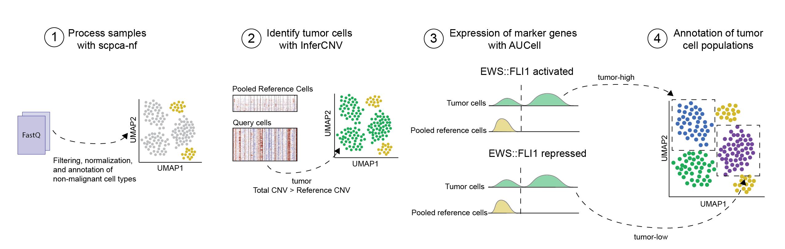
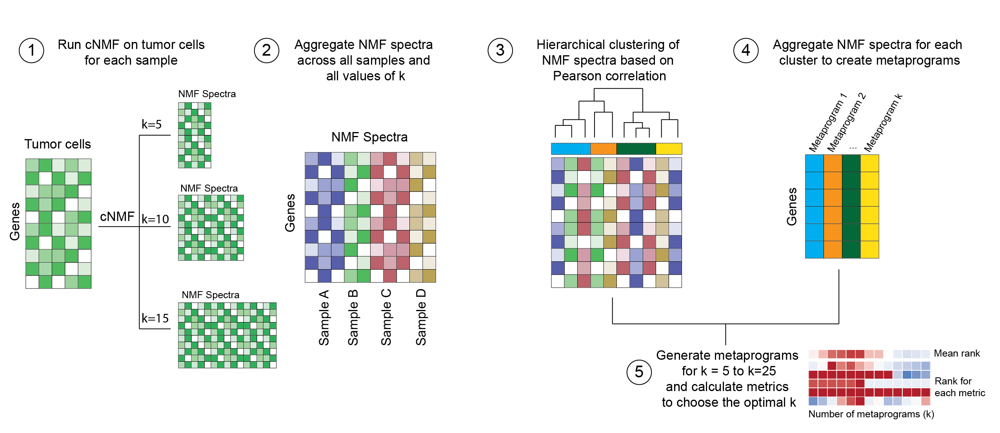

# ews-nf

<!-- START doctoc generated TOC please keep comment here to allow auto update -->
<!-- DON'T EDIT THIS SECTION, INSTEAD RE-RUN doctoc TO UPDATE -->
**Table of Contents** 

- [Description](#description)
  - [Reference workflow](#reference-workflow)
  - [Annotation workflow](#annotation-workflow)
  - [Metaprogram workflow](#metaprogram-workflow)
  - [Identifying shared metaprograms](#identifying-shared-metaprograms)
- [Prerequisites](#prerequisites)
- [Running the workflow](#running-the-workflow)
  - [Building the normal reference](#building-the-normal-reference)
  - [Running the main annotation workflow](#running-the-main-annotation-workflow)
  - [Running the metaprogram identification workflow](#running-the-metaprogram-identification-workflow)
  - [Comparing metaprograms across subsets](#comparing-metaprograms-across-subsets)
  - [Subset mode](#subset-mode)
  - [Parameters](#parameters)
  - [Profiles](#profiles)
  - [Running the workflow on the Pittsburgh High Throughput Cluster](#running-the-workflow-on-the-pittsburgh-high-throughput-cluster)
    - [Reference building and annotation](#reference-building-and-annotation)
    - [Metaprograms](#metaprograms)
- [Monitoring the workflow with Seqera](#monitoring-the-workflow-with-seqera)
- [Output files](#output-files)
  - [Reference files](#reference-files)
  - [Annotation files](#annotation-files)
  - [Metaprogram files](#metaprogram-files)
- [Managing software dependencies](#managing-software-dependencies)
  - [Additional software not managed with `renv`](#additional-software-not-managed-with-renv)

<!-- END doctoc generated TOC please keep comment here to allow auto update -->

## Description

This repository holds a Nextflow workflow used to analyze single-cell RNA-sequencing samples obtained from patients with Ewing sarcoma.

Prior to running this workflow, single-cell RNA-sequencing samples must be processed with [`scpca-nf`](https://github.com/AlexsLemonade/scpca-nf).

The repository provides four workflow entry points, specified with the `--workflow` parameter:

- [`reference`](#reference-workflow) — builds the pooled normal-cell reference and the inferCNV gene order file used in the `annotation` workflow.
- [`annotation` (default)](#annotation-workflow) — annotates tumor cells in individual samples.
- [`nmf_metaprograms`](#metaprogram-workflow) — identifies recurrent gene expression programs or metaprograms across the tumor cells of many samples.
- [`shared_metaprograms`](#identifying-shared-metaprograms) — compares metaprograms derived from sample subsets against those derived from the full cohort.

### Reference workflow

Prior to annotating tumor cells, the reference workflow (`reference`) is used to generate a pooled reference of normal cells across all input samples and the gene order file needed for `inferCNV`. 

This workflow extracts the counts for any cells that should be included in a normal cell reference and saves to a single `SingleCellExperiment` object for use with other modules. 
An additional TSV file containing the library ID, cell barcode, and consensus cell type annotations is also saved.
Any cells with a consensus cell type present in the table of reference cell types (see [`references/reference-celltypes.tsv`](./references/reference-celltypes.tsv)) will be included in the normal reference. 

This workflow must be run on all samples prior to using the annotation (`annotation`) workflow described below.

### Annotation workflow



The main workflow (`annotation`), used to annotate tumor cells, is organized into the following modules:

* `aucell`: [`AUCell`](https://www.bioconductor.org/packages/release/bioc/html/AUCell.html) is used to calculate the AUC for all provided gene sets on each cell in the input `SingleCellExperiment` object. 
Gene sets used are found in `genesets/msigdb-gene-sets.tsv` and `genesets/custom-gene-sets.tsv`. 
Once `AUCell` is run on each object, the AUC results for all cells belonging to the normal reference are used to build a background distribution. 
The mean and standard deviation of the background distribution are used to obtain a z-score for the AUC results from all cells in each sample. 
* `infercnv`: [`inferCNV`](https://github.com/broadinstitute/inferCNV/wiki) is used to infer copy number variations in all non-reference cells. 
All cells that are classified as reference cells using the `build-reference` module are used as a normal reference to run `inferCNV` on each library. 
A TSV file containing the estimated CNV profile for each cell along with a heatmap displaying the output from `inferCNV` are saved for each library. 
In addition, the total CNVs are summed and the mean and standard deviation of the reference cells are used to obtain a z-score for the total CNVs from all cells in each sample. 
This same approach is used to calculate the z-score for all `proportion_scaled_*` columns that represent commonly observed CNVs in Ewing sarcoma (gain of chr1, gain of chr8, gain of ch12, and loss of chr16). 
* `annotate-tumor-cells`: Annotations are assigned to all cells based on the CNV and AUCell z-scores: 
  * Tumor cells are identified as those with a CNV z-score (total or Ewing specific CNV) > 2 (tier2), > 1 (tier1), or > 0 (tier0). 
  * Any cells that are tumor cells are further classified into `high` or `low` based on expression of `EF-activated` (high) or `EF-repressed` (low) gene sets as indicated by `AUCell`. 
  The z-score for each gene set is determined and the mean z-score for all gene sets categorized as either `EF-activated` or `EF-repressed` is calculated. 
  Cells are classified if the mean z-score is greater than the specified `--marker_gene_cutoff`, which has a default of 2. 
* `summary-report`: This module generates a HTML report summarizing the results from the workflow for each sample. 

### Metaprogram workflow



The tumor cells output from the annotation workflow are then used as input to a workflow used to annotate metaprograms across all samples (`nmf_metaprograms`). 
That workflow is organized into the following modules: 

* `cnmf`: This module runs [`cNMF`](https://github.com/dylkot/cNMF) on all tumor cells over a range of `k` values.
  * Here, tumor cells are those that are labeled as tumor by the `annotation` workflow with a CNV z-score > 0 (tier0).
  * By default the range of `k` values is defined by `--k_components_lower` (5), `--k_components_upper` (15), and `--k_step_size` (5).
  * The column and value used to select cells are controlled by `--annotations_column` (default `annotation_tier0`) and `--celltype_value` (default `tumor`).
  * The consensus NMF program for each value of `k` is included in the output.
* `metaprograms`: This module clusters the cNMF spectra across samples to generate shared metaprograms. 
  * As the number of clusters must be pre-determined, this module generates metaprograms using a range of k clusters specified using the `--n_metaprograms` parameter (default `8,9,10,11`). 
  * A set of metrics is then calculated for each set of metaprograms and the optimal number of metaprograms is identified. 
  * The output from this module includes the optimal set of metaprograms, a TSV file ontaining scores for all cells in all samples, and `two associated reports, `combined-metaprograms-metrics.html` and `k-<optimal n_metaprograms>_metaprograms-summary-report.html`. 

### Identifying shared metaprograms 

The workflow (`shared_metaprograms`) compares the metaprograms generated for a sample subset against those generated for the full cohort and exports a TSV of comparison metrics per subset.

## Prerequisites

- [Nextflow](https://www.nextflow.io/) `>=24.09`.
- A container engine: Docker (used by the `standard` profile) or Singularity (used by the `pitt_htc` profile).
- Quantified gene expression data produced by [`scpca-nf`](https://github.com/AlexsLemonade/scpca-nf).
The processed `SingleCellExperiment` (`_processed.rds`) and `AnnData` (`_processed_rna.h5ad`) objects output from that workflow are used as input to `ews-nf`.
For more information on `scpca-nf`, please see the [`scpca-nf` documentation](https://github.com/AlexsLemonade/scpca-nf/blob/main/external-instructions.md), including the section describing the [expected output structure](https://github.com/AlexsLemonade/scpca-nf/blob/main/external-instructions.md#output-files). 

**Note:** Libraries with fewer than 200 processed cells are excluded from processing when running the annotation or nmf_metaprograms workflow. 
A message is included in the log file for each skipped library.

## Running the workflow 

<!--
TODO: remove this and update running commands to use the public workflow rather than a local copy 
Every nextflow run main.nf should be replaced with nextflow run AlexsLemonade/ews-nf
-->
In order to run the full workflow you will first need to clone the repository. 

The different entry points specified with the `--workflow` parameter should be run in the following order: 

1. `reference`: Build the pooled normal cell reference for all samples. 
2. `annotation`: Annotate tumor cells across all samples. 
3. `nmf_metaprograms`: Identify shared metaprograms across the full set of samples. 
4. (Optional) `nmf_metaprograms` with [`--subset_mode`](#subset-mode): Generates shared metaprograms across specific groups of samples or subsets. 
5. (Optional) `shared_metaprograms`: Compare metaprograms from each sample subset to those identified in the full cohort. 

### Building the normal reference

Prior to annotating the cells in individual samples, the `reference` workflow should be used to build the necessary reference files. 
This includes the pooled normal cell reference files and the gene order file to be used with `InferCNV`. 

The pooled reference will include cells from all samples present in the specified `scpca-nf` output directory (`scpca_nf_dir` parameter). 
Specifically, the processed `SingleCellExperiment` objects (`processed.rds` files) output from `scpca-nf` are used to grab consensus cell type annotations used to build the pooled reference. 

The following command can be used to run the reference part of the workflow: 

```sh
nextflow run main.nf --workflow reference
```

### Running the main annotation workflow

After creating the reference files with the `reference` workflow, the `annotation` workflow can be used to annotate tumor cells in each individual sample. 
This workflow requires the pooled reference files output from the `reference` workflow and processed `SingleCellExperiment` objects (`processed.rds` files) output from `scpca-nf`.

The following command can be used to run the annotation workflow locally with all default [parameters](#parameters):

```sh
nextflow run main.nf
```

### Running the metaprogram identification workflow

After annotating tumor cells using the main workflow, the `nmf_metaprograms` workflow can be used to identify metapgrograms across a group of samples. 
This workflow requires: 

- the processed `AnnData` objects (`processed_rna.h5ad` files) output from `scpca-nf` 
- the processed `SingleCellExperiment` objects (`processed.rds` files)
- and the tumor cell annotations TSV (`annotations/<sample_id>/<library_id>_annotations.tsv`) file output from the main `ews-nf` workflow. 

By default, all samples with processed files (`processed_rna.h5ad` and `processed.rds`) detected in the `scpca_nf_dir` will be used as input to generating metaprograms. 
To generate metaprograms for a specific subset of samples, see [Subset mode](#subset-mode).

The following command can be used to generate metaprograms: 

```sh
nextflow run main.nf --workflow nmf_metaprograms
```

### Comparing metaprograms across subsets

The `shared_metaprograms` workflow compares metaprograms generated for each sample subset (see [Subset mode](#subset-mode)) against the metaprograms generated for the full cohort.
It requires that `nmf_metaprograms` has already been run for both the relevant subsets and the full cohort, so that the corresponding `*_metaprograms.rds` files exist in the output directory.
Subsets are defined in the file given by `--subset_tsv` (see [Subset mode](#subset-mode)).

```sh
nextflow run main.nf --workflow shared_metaprograms
```

### Subset mode

The `nmf_metaprograms` workflow supports running on defined subsets of samples instead of using the default mode of running all samples in the provided `scpca_nf_dir`. 
Subsets are specified in a TSV file (`--subset_tsv`, default [`sample-info/sample-subsets.tsv`](./sample-info/sample-subsets.tsv)) that must contain the columns `subset_id` and `scpca_sample_id`.

- When `--subset_mode` is `false` (the default), all samples are treated as a single group labeled `full_cohort`.
- When `--subset_mode` is `true`, samples are grouped according to `subset_tsv`, and `--subset_ids` can be used to restrict processing to a comma- or semicolon-separated list of subset IDs (default `All`).

The following command can be used to run the `nmf_metaprograms` workflow with subset mode: 

```sh
nextflow run main.nf --workflow nmf_metaprograms \
  --subset_mode \
  --subset_ids <optional comma separated list of subset ids> 
```

If the `nmf_metaprograms` are run across a set of subsets and the full cohort, the [`shared_metaprograms` workflow](#comparing-metaprograms-across-subsets) can be used to compare metaprograms from each subset to the full cohort. 

### Parameters

Below is a table of parameters that can be modified: 
Parameters are validated using the schema in [`nextflow_schema.json`](./nextflow_schema.json), which is the authoritative source for the full list, types, and defaults. The most commonly modified parameters are summarized below.

**Global parameters**

| Parameter | Default | Description |
| --- | --- | --- |
| `workflow` | `annotation` | Which workflow to run: `reference`, `annotation`, `nmf_metaprograms`, or `shared_metaprograms`. |
| `scpca_nf_dir` | `scpca-nf-out` | Path to the directory containing output from `scpca-nf`. |
| `sample_ids` | `All` | Comma- or semicolon-separated list of sample IDs (folder names in `scpca_nf_dir`) to run on. Use `All` to run on every sample present. |
| `outdir` | `ews-nf-out` | Directory to save output files from `ews-nf`. |
| `seed` | `2025` | Random seed for reproducibility. |

**Container parameters**

| Parameter | Default | Description |
| --- | --- | --- |
| `ews_nf_container` | `ghcr.io/alexslemonade/ews-nf:edge` | Image used for most modules. |
| `cnmf_container` | `ghcr.io/alexslemonade/ews-nf/cnmf:edge` | Image used for the `cnmf` module. |

**Reference and annotation parameters**

| Parameter | Default | Description |
| --- | --- | --- |
| `ref_celltypes_file` | `references/reference-celltypes.tsv` | Consensus cell types to include when building the normal reference. |
| `gtf_file` | `s3://scpca-nf-references/homo_sapiens/ensembl-110/annotation/Homo_sapiens.GRCh38.110.gtf.gz` | GTF reference used to build the inferCNV gene order file. |
| `custom_genesets_file` | `genesets/custom-gene-sets.tsv` | Table of custom gene sets for AUCell. |
| `msigdb_genesets_file` | `genesets/msigdb-gene-sets.tsv` | Table of MSigDB gene sets for AUCell. |
| `aucell_max_rank_threshold` | `0.01` | Proportion of detected genes used as the max AUC rank threshold. |
| `marker_gene_cutoff` | `2` | z-score cutoff for classifying cells as `high` (EF-activated) or `low` (EF-repressed). |
| `skip_infercnv` | `false` | Skip re-running inferCNV for samples with existing results. |

**cNMF / metaprogram parameters**

| Parameter | Default | Description |
| --- | --- | --- |
| `annotations_column` | `annotation_tier0` | Annotations column used to select cells for cNMF. |
| `celltype_value` | `tumor` | Value in `annotations_column` identifying cells to use for cNMF. |
| `k_components_lower` | `5` | Lower bound of `k` components for cNMF. |
| `k_components_upper` | `15` | Upper bound of `k` components for cNMF. |
| `k_step_size` | `5` | Step size for the range of `k` components. |
| `cnmf_k_range` | `all` | Comma-separated set of `k` values to keep when clustering spectra (or `all`). |
| `n_metaprograms` | `8,9,10,11` | Range of number of metaprograms evaluated to find the optimal `k`. |
| `filter_spectra` | `false` | Whether to filter orphan spectra before generating metaprograms. |
| `orphan_cutoff` | `0.3` | Minimum cross-sample maximum required to keep spectra when `filter_spectra` is true. |
| `skip_cnmf` | `false` | Skip re-running cNMF for samples with existing results. |
| `score_sces` | `false` | Whether to score and annotate SCEs with the optimal value of `k`. |

**Subset parameters**

| Parameter | Default | Description |
| --- | --- | --- |
| `subset_tsv` | `sample-info/sample-subsets.tsv` | TSV of sample subsets; must contain `subset_id` and `scpca_sample_id` columns. |
| `subset_mode` | `false` | Run metaprograms on subsets from `subset_tsv` instead of the full cohort. |
| `subset_ids` | `All` | Comma-separated subset IDs to process when `subset_mode` is true. |

Below is an example of running the workflow and specifying different parameters:

```sh
nextflow run main.nf \
  --scpca_nf_out <path to scpca-nf output> \
  --sample_ids <comma separated list of sample ids> \
  --outdir <path to directory to save output from workflow>
```

### Profiles 

`ews-nf` can be run using three different profiles: 

- `standard`: This is the default profile. 
If no profile is specified, then the workflow will use this profile and run the workflow locally.

To use the `standard` profile run: 

```sh
nextflow run main.nf
```

- `pitt_hpc`: This profile can be used to run the workflow using the Pittsburgh High Throughput Cluster (HTC). 
**Note:** It is not recommended to run the workflow from the login node on the HTC. 
Instead, please follow the [instructions on running the workflow using the HTC below](#running-the-workflow-on-the-pittsburgh-high-throughput-cluster). 

To use the `pitt_htc` profile run: 

```sh
nextflow run main.nf -profile pitt_htc
```

- `stub`: This profile can be used for testing the workflow configuration and process input/outputs. 

To use the `stub` profile run: 

```sh
nextflow run main.nf -profile stub -stub 
```

### Running the workflow on the Pittsburgh High Throughput Cluster

#### Reference building and annotation

The `slurm-submit.sh` script can be used to run `ews-nf` on the Pittsburgh High Throughput Cluster (HTC) using the `pitt_htc` profile. 
This script runs the workflow with `--workflow reference` to build the pooled reference for all samples and then runs the main annotation workflow. 

You will need to clone the repository into your home directory and then use the following command to submit the workflow to the SLURM workload manager: 

```sh
sbatch slurm-submit.sh
```

To modify any of the workflow parameters, specify them at the command line when submitting to SLURM: 

```sh
sbatch slurm-submit.sh --scpca_nf_dir [full path to results folder output from scpca-nf] 
```

If the repository is not located in your home directory, be sure to provide the full path to the repo using the `--project_dir` argument: 

```sh
sbatch slurm-submit.sh --project_dir [full path to cloned repository]
```

The `--sample_ids` argument can be used to specify a subset of samples to annotate: 

```sh
sbatch slurm-submit.sh --sample_ids "SCPCSXXXXXX,SCPCSXXXXXX"
```

To skip running inferCNV for any samples with existing inferCNV results, use: 

```sh
sbatch slurm-submit.sh --skip_infercnv 1
```

By default, if the reference files exist, the reference building (`--workflow reference`) will not be re-run. 
To overwrite an existing reference, use `--overwrite_reference 1`

```sh
sbatch slurm-submit.sh --overwrite_reference 1
```

#### Metaprograms

To run the workflow for generating metaprograms or comparing metaprograms, use the `slurm-submit-nmf.sh` script after running the main `ews-nf` workflow with `slurm-submit.sh`. 
This script can be run using the following command: 

```sh
sbatch slurm-submit-nmf.sh
```

To skip running cNMF for any samples with existing cNMF results, use: 

```sh
sbatch slurm-submit-nmf.sh --skip_cnmf 1
```

To skip regenerating metaprograms for sample cohorts with existing metaprograms, use: 

```sh
sbatch slurm-submit-nmf.sh --skip_metaprogram_generation 1
```

This script can also be used to generate metaprograms for subsets using [Subset mode](#subset-mode).
If `--subset_mode 1` is provided at the command line, then metaprograms are first generated for all subsets using `--workflow nmf_metaprograms` and then the subsets are compared to the full cohort using `--workflow shared_metaprograms`. 

To run the workflow with subset mode, use: 

```sh
sbatch slurm-submit-nmf.sh --subset_mode 1 --subset_ids "<comma separated list of ids>"
```


## Monitoring the workflow with Seqera 

To track the progress of the workflow run, you can optionally use the [Seqera platform](https://tower.nf/).
Seqera provides some nice visualizations of the resource usage of each job, as well as a easy to navigate record of run logs that can be useful for debugging.
You will need to create an account on https://tower.nf/ (it is recommended to use your github account for this).

You can then follow the instructions on running [Nextflow using the `-with-tower` flag](https://docs.seqera.io/platform-cloud/getting-started/deployment-options#nextflow--with-tower) to create a new token.
Next, you will want to create an environment variable with this token value using the following command at the command line: `export TOWER_ACCESS_TOKEN=<MYTOWERTOKEN>`
We recommend that you also add this line to your `~/.bash_profile` or equivalent (`~/.zshrc`).

To run the workflow using Seqera, use the following command: 

```sh
nextflow run main.nf -with-tower
```

Any runs of the workflow on the Pittsburgh HTC using the `pitt_htc` profile will appear on the Seqera Platform in the `ews-nf` workspace here: https://cloud.seqera.io/orgs/SeanKarlCohort/workspaces/ews-nf/watch 

You must be a member of the `SeanKarlCohort` organization and have access to the `ews-nf` workspace to monitor runs.

## Inpuut files 

Prior to running any of the individual workflows within `ews-nf`, samples must be processed using [`scpca-nf`](https://github.com/AlexsLemonade/scpca-nf). 
The `--scpca_nf_dir` parameter should be used to specify the directory with the output files from `scpca-nf` and should have the following structure. 
Files explicitly used by `ews-nf` are denoted in the file structure: 

```tree
results
└── {project_id}
    └── {sample_id}
        ├── {library_id}_unfiltered.rds
        ├── {library_id}_filtered.rds
        ├── {library_id}_processed.rds # required by ews-nf
        ├── {library_id}_unfiltered_rna.h5ad
        ├── {library_id}_filtered_rna.h5ad
        ├── {library_id}_processed_rna.h5ad # required by ews-nf
        ├── {library_id}_metadata.json # required by ews-nf
        └── {library_id}_qc.html
```

**Note:** The `--scpca_nf_dir` parameter is used to automatically detect all samples that should be processed. 
Therefore, any sample with processed files (`processed.rds` and `processed_rna.h5ad`) will be automatically run through `ews-nf`. 


## Output files 

### Reference files 

Running the workflow with the `reference` workflow will output three reference files found in `<output_dir>/reference`: 

- A gene order file for use with `inferCNV`. 
The name of the file will be representative of the Ensembl version used to create the file, e.g., `Homo_sapiens.GRCh38.110.gene_order.txt`. 
- A TSV file with the cell types for all cells included in the pooled reference, `all-ref-annotations.tsv`.
- An RDS file with a `SingleCellExperiment` object containing the counts for all cells included in the pooled reference, `all-ref-sce.rds`

### Annotation files 

The main annotation workflow will include a folder with results from each module organized as follows: 

```tree
ews-nf-out
├── annotations
│   └── <sample_id>
│       └── <library_id>-<sample_id>_annotations.tsv
├── aucell
│   └── <sample_id>
│       └── <library_id>-<sample_id>_aucell-results.tsv
├── infercnv
│   └── <sample_id>
│       ├── <library_id>-<sample_id>_infercnv-heatmap.png
│       └── <library_id>-<sample_id>_infercnv-metadata.tsv
└──  reports
    └── <sample_id>
        └── <library_id>-<sample_id>_summary-report.html

```

The `<library_id>-<sample_id>_summary-report.html` file contains plots and tables to visualize the results from the workflow. 
The summarized results, including the final annotations, are available in the `<library_id>-<sample_id>_annotations.tsv` file, which contains the following columns: 

| column | contents | 
| ------ | -------- | 
| `barcodes` | Cell barcode | 
| `unique_id` | Unique sample identifier in the format, `<library_id>-<sample_id>` | 
| `cell_id` | Unique cell identifier in the format, `<library_id>-<sample_id>-<barcode>` | 
| `consensus_celltype_annotation` | Original consensus cell type annotation assigned by `scpca-nf` |
| `ref_or_query` | Whether the cell is part of the pooled reference (`reference`) or query cell (`query`) | 
| `EF-activated` | Mean z-score of all `EWS::FLI1` activated gene sets output by `AUCell` | 
| `EF-repressed` | Mean z-score of all `EWS::FLI1` repressed gene sets output by `AUCell` | 
| `EMT-ECM` | Mean z-score of all EMT and ECM related gene sets output by `AUCell` | 
| `cnv_zscore` | Total CNV z-score | 
| `chr1_gain_zscore` | Proportion of chr1 with CNV gain z-score | 
| `chr8_gain_zscore` | Proportion of chr8 with CNV gain z-score | 
| `chr12_gain_zscore` | Proportion of chr12 with CNV gain z-score | 
| `chr16_loss_zscore` | Proportion of chr16 with CNV loss z-score | 
| `tumor_class` | Indicates if cells are classified as tumor using CNV > 2 (`tumor_tier2`), CNV > 1 (`tumor_tier1`), or CNV > 0 (`tumor_tier0`) or classified as normal | 
| `expression_class` | Indicates if cells have a `EF-activated` (`high`) or `EF-repressed` (`low`) z-score greater than the marker gene threshold (default: 2). `NA` is used to indicate if the cell does not pass either threshold |
| `annotation_tier0` | Combined annotation based on `tumor_class`, `expression_class`, and `consensus_celltype_annotation. Here tumor cells are those that have CNV > 0 | 
| `annotation_tier1` | Combined annotation based on `tumor_class`, `expression_class`, and `consensus_celltype_annotation. Here tumor cells are those that have CNV > 1 | 
| `annotation_tier2` | Combined annotation based on `tumor_class`, `expression_class`, and `consensus_celltype_annotation. Here tumor cells are those that have CNV > 2 | 

### Metaprogram files

The `nmf_metaprograms` workflow writes cNMF and metaprogram results under `<outdir>`. 
When running the workflow in the default mode, the output structure will be as follows:

```tree
ews-nf-out
├── cnmf
    └── <sample_id>\
└── metaprograms
    └── <full_cohort/subset_id>
        ├── k-<optimal n_metaprograms>_metaprograms.rds
        ├── k-<optimal n_metaprograms>_metaprogram_scores.tsv.gz
        ├── k-<optimal n_metaprograms>_metaprograms-metrics.rds
        ├── k-<optimal n_metaprograms>_metaprograms-summary-report.html
        ├──combined-metaprograms-metrics.html
        └── metaprograms-<n_metaprograms>_cnmf-<cnmf k range>_<filtered or unfiltered>/
            ├── k-<n_metaprograms>_metaprograms.rds
            ├── k-<n_metaprograms>_metaprogram_scores.tsv.gz
            ├── k-<n_metaprograms>_background_scores.tsv.gz
            └── k-<n_metaprograms>_metaprograms-metrics.rds

```

If `--subset_mode` is used, results are grouped by subset ID. 
Additionally, only the optimal metaprograms are included in the output directory.

```tree
ews-nf-out
├── cnmf
    └── <sample_id>\
└── metaprograms
    └── <subset_id>
        ├── k-<optimal n_metaprograms>_metaprograms.rds
        ├── k-<optimal n_metaprograms>_metaprogram_scores.tsv.gz
        ├── k-<optimal n_metaprograms>_metaprograms-metrics.rds
        ├── k-<optimal n_metaprograms>_metaprograms-summary-report.html
        ├──combined-metaprograms-metrics.html
        └── <subset_id>_metaprograms-comparison-metrics.tsv   # from shared_metaprograms workflow
```

The `shared_metaprograms` workflow adds, for each subset, a `<subset_id>_metaprograms-comparison-metrics.tsv` file comparing that subset's metaprograms to the full-cohort metaprograms.

## Managing software dependencies 

All R packages are managed with `renv` and a Dockerfile is used to build an image with R, Bioconductor, and all packages included in `renv`. 
This is the default image used for most processes within the workflow that utilize R.

The following command can be used to build the image: 

```sh
docker buildx build . -t ews-nf --platform linux/amd64
```

Alternatively, the latest version should be available via:

```sh
docker pull ghcr.io/alexslemonade/ews-nf:edge
```

To add any packages to the image outside of `renv`, the `Dockerfile` should be updated to include installation of the desired package.
This image is built and pushed to `ghcr.io/alexslemonade/ews-nf:edge` automatically on every update to `ews-nf` (`main`) in which the `Dockerfile` or `renv.lock` files are changed.

### Additional software not managed with `renv`

The `docker` folder contains any additional images that are built for processes that utilize packages that are not managed within `renv`. 

* The `cnmf` folder contains a `pixi.lock` and `Dockerfile` used to build the `ews-nf/cnmf` Docker image. 
This image is used for running the [`cNMF` package](https://github.com/dylkot/cNMF) within the `ews-nf` workflow. 
This image is built and pushed to `ghcr.io/alexslemonade/ews-nf/cnmf:edge` automatically on every update to `ews-nf` (`main`) in which the `docker/cnmf/Dockerfile` or `docker/cnmf/pixi.lock` files are changed.
